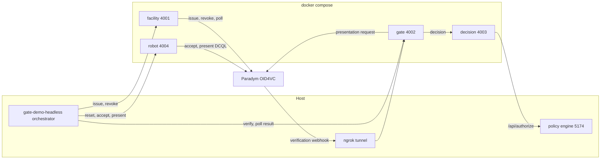
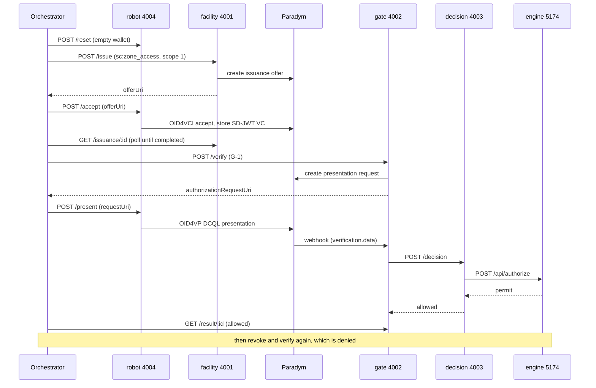

# Stormcatch Credential Core

Credential-lifecycle spine for autonomous robot gate-authorisation, built on [Paradym](https://paradym.id) (OID4VCI issuance, OID4VP verification, SD-JWT VC, status-list revocation).

A robot arrives at a gate and is allowed or denied. The whole flow runs as independent containerised services with no phone wallet: a headless [Credo](https://credo.js.org) holder receives and presents the credential over OID4VP DCQL, Paradym verifies it, and the allow/deny decision comes from the Stormcatch policy engine.

The same services carry the pilot's medicine delivery: the pharmacy loads a robot and the central server issues it a task token (its delivery code), the robot carries the code through the gates, and the ward checks it and accepts or refuses the load. See [Interaction points](#interaction-points-pickup-and-drop-off).

## Services

The credential backend is four containers, plus the policy engine which runs as its own service.

| Service | Port | Role | Key endpoints | API docs |
|---|---|---|---|---|
| facility | 4001 | Issuer. Issues and revokes TaskAuthorization credentials. | `POST /issue`, `GET /issuance/:id`, `POST /revoke` | `/docs` |
| gate | 4002 | Verifier (checkpoint). Starts the presentation request, receives the Paradym webhook, delegates the decision. | `POST /verify`, `GET /result/:id`, `POST /webhook` | `/docs` |
| decision | 4003 | Adapter. Turns a friendly request into the engine's full AuthorizeBody and forwards it. Fills the payload facts from the robot's task token when a desk sends it, a procedure A stand-in otherwise. | `POST /decision` | `/docs` |
| robot | 4004 | Headless Credo holder. Receives and presents credentials, no phone wallet, and carries the robot's delivery codes in its wallet. | `POST /accept`, `POST /present`, `POST /reset`, `POST/GET /deliveries`, `DELETE /deliveries/:taskId` | `/docs` |
| pickup | 4005 | Manned interaction point (engine `I-1`). Plans tasks, checks the robot and, on "Loaded", has the central server issue the token for its planned task. | `POST /pickup/tasks`, `POST /pickup/check`, `POST /pickup` | `/docs` |
| central | 4007 | The issuer of task tokens (Martin's task JWT format) and the record of tasks and activity. Issues on request from the pickup desk, revokes over MQTT on receipt, refusal or recall. | `POST /tasks`, `POST /tasks/:id/issue`, `POST /tasks/:id/recall`, `GET /tasks`, `GET /activity` | `/docs` |
| dropoff | 4006 | Manned interaction point (engine `I-2`, the ward; a second instance on 4008 serves `I-3`, the clean-room ward). Verifies the task token, takes the nurse's answer (accepted, or refused with a reason) and has the central server revoke the token over MQTT. | `POST /dropoff/check`, `POST /dropoff` | `/docs` |
| broker | 1883 | Mosquitto. Carries payload revoke requests and the retained revoked list. | MQTT | - |
| policy engine | 5174 | RDI's `@stormcatch/authoriser`. Runs the staged pipeline (Layer 1, trust, deny, Cedar). Own repo. | `POST /api/authorize`, `/api/docs` | `/api/docs` |

Every service serves its OpenAPI document at `/openapi.json` and Swagger UI at `/docs`. `pnpm docs:check` fails if any service's routes drift from its spec.

## Architecture



## Gate-authorisation lifecycle

`pnpm gate-demo-headless` runs the whole thing with no phone wallet.



## Running it

On a developer machine the easiest way to run everything is the PM2 launcher in `stormcatch-dev-stack`, a folder next to this repo (`./stack up all`, `./stack check`, `./stack logs <service>`; its README has the details). The steps below run the gate lifecycle with Docker.

You need a Paradym account (two wallets: one facility/issuer, one gate/verifier), the policy engine repo checked out as a sibling, ngrok, and Docker.

```bash
# 1) Configure .env (Paradym API key, facility + gate wallet ids, template ids)

# 2) Policy engine (RDI, on the host). It must bind 0.0.0.0 with a token to be
#    reachable from the decision container.
cd ../stormcatch-policy-sdk
HOST=0.0.0.0 TESTER_TOKEN=<16+ chars> pnpm --filter @stormcatch/authoriser api

# 3) The credential stack (four containers)
cd ../credential_lifecyle
docker compose up --build

# 4) Paradym verification webhook: ngrok fronts the gate, then register it
ngrok http 4002
pnpm register-webhook https://<ngrok-url>

# 5) Full lifecycle in one command
pnpm gate-demo-headless
```

Expected: verify at G-1 is `allowed`, then after revoke it is `denied`.

Individual services can also be run on the host without Docker: `pnpm facility`, `pnpm gate`, `pnpm decision`, `pnpm central`, `pnpm pickup`, `pnpm dropoff`, and `pnpm robot` (from `robot-agent/`). The clean-room ward's desk is a second drop-off: `DROPOFF_POINT_ID=I-3 DROPOFF_PORT=4008 pnpm dropoff`.

### Testing

`pnpm test` runs every contract test. A test that needs a service which is not running is skipped, not failed, so run it with the stack up. `pnpm docs:check` checks every service's routes against its OpenAPI spec. To ask the engine by hand what a gate or desk would ask:

```sh
curl -s -X POST localhost:4003/decision -H 'content-type: application/json' -d '{"pointId":"G-1","action":"sc:zone_access","scope":"1"}'
```

`allowed` is the verdict, `determiningPolicies` why, and `payload` where the payload facts came from (`token`, `held`, `none`, or `baseline` for the stand-in).

## Interaction points (pickup and drop-off)

The medicine delivery of pilot procedures A (pharmacy `I-1` to ward `I-2`) and B (to the clean-room ward `I-3`):

1. **Plan.** The pharmacy plans a task for a robot (`POST /pickup/tasks`); the central server keeps it, one planned task per robot.
2. **Pick up.** The robot arrives at the counter. The pickup desk asks the engine whether it may collect: the engine refuses a robot that is still out with another load. On "Loaded" the central server issues the task token, an ES256 JWT naming the robot, the route, the items and the class of goods (`sc:medicine`), valid for 2 hours. The desk hands it to the robot, which keeps it in its wallet.
3. **Travel.** The robot passes the gates (zone access, below). The gates do not read the token yet.
4. **Hand over.** At the ward the nurse scans the robot; the desk asks the robot for its code. Drop-off verifies the token (signature, addressed to this ward, this robot, not revoked), asks the engine with the token's payload facts, and shows what the robot brings. The nurse accepts it, or refuses it with one of four reasons (not what was ordered, damaged, nobody expected it, too late).
5. **Close.** Either answer has the central server revoke the token over MQTT; drop-off answers only once the revoke is confirmed. The task becomes `received`, or `refused` and the robot takes the load back to the pharmacy. The robot drops the code. A delivery on its way can also be recalled by the pharmacy.

Every step lands in the central server's activity log, per task. The flow, the sequence diagram, the decisions (numbered) and assumptions behind them, and the settings are in [docs/interaction-points.md](docs/interaction-points.md); the box test plan is in [docs/interaction-points-next.md](docs/interaction-points-next.md), and verifying the person at the ward (not built) in [docs/dropoff-staff-verification.md](docs/dropoff-staff-verification.md).

The screens: the user-facing app `credential-lifecycle-app`, a separate repo next to this one (pharmacy and ward desks as conversations, the control room, delivery stories on the floor plan) and the developer and test UI [credential-lifecycle-ui](https://github.com/Stormcatch/credential-lifecycle-ui).

## Trust model

Two Paradym wallets separate the actors. The facility wallet is the issuer; the gate wallet is the verifier. The issuer identifier is a `did:web` (`did:web:metadata.paradym.id:...`), pinned on the verifier as a trusted entity that the gate's presentation template references, so the verifier only accepts credentials from that issuer.

The policy engine runs a second, independent trust check (Layer 1 plus a trust list). In the current pilot phase the decision-service sends an anchored `did:key` placeholder as the credential issuer so the engine's trust stage passes; aligning the engine's trust list to screen the real `did:web` issuer is a planned follow-up.

The task token has two issuers in two roles. The central server signs it (`iss urn:stormcatch:central`); the desks and the decision-service verify that signature with its public key. The engine is told the payload's issuer is the pharmacy the load came from (`did:key:z6MkAmcPharmacy00001` for `I-1`), because its trust list anchors issuers by DID and procedure A has the pharmacy issue the payload.

## Notes and gotchas

- The gate service must run with `SERVICE_ROLE=gate` (the container sets it) or it defaults to the facility wallet.
- Every service listens on all interfaces unless `FACILITY_HOST`, `GATE_HOST`, `DECISION_HOST` or `ROBOT_HOST` names one. None of them authenticates its caller, so on a shared machine set it to `127.0.0.1` and reach the service through an SSH tunnel.
- The engine binds loopback by default and is unreachable from a container; run it with `HOST=0.0.0.0` and a `TESTER_TOKEN`, and the decision-service authenticates with that token over `host.docker.internal`.
- ngrok must point at port 4002 and the webhook must be re-registered after every ngrok restart, or the gate never receives the verification result and the request times out as a deny.
- Compose reads `.env` only when a container is created; after editing `.env` run `docker compose up -d --force-recreate <service>`.
- Presentation template ids change when templates are re-created; keep `.env` in sync (`pnpm task-setup` prints the new gate ids).

## Repository layout

- `src/services/` - the facility, gate, decision, central, pickup and dropoff HTTP services, each with its `openapi.ts` spec.
- `src/payload/` - the task token (`PayloadBackend` interface, JWT backend, points, routes and payload issuers, blacklist, task store and activity log) and MQTT revocation by proxy.
- `broker/` - the Mosquitto config, ACL and start script for the revocation broker.
- `docs/` - design notes, including the interaction-point decisions.
- The desk screens live in the user-facing app, `credential-lifecycle-app` (a separate repo next to this one), and in the developer and test UI, [credential-lifecycle-ui](https://github.com/Stormcatch/credential-lifecycle-ui).
- `src/scripts/` - setup scripts (templates, trust, webhook) and orchestrators (`gate-demo`, `gate-demo-headless`).
- `src/credentials/`, `src/templates/`, `src/dids/` - the Paradym credential, template and DID helpers.
- `robot-agent/` - the headless Credo 0.7.0 holder (its own package) exposing the robot-service.
- `docker-compose.yml`, `Dockerfile`, `robot-agent/Dockerfile` - the containerised stack.
