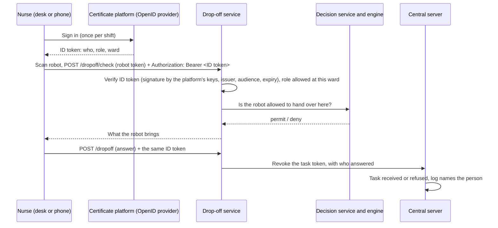

# Verifying the person at the drop-off

Design only, written 2026-11-23. Nothing here is built yet: it waits for the sign-in on Martin's certificate platform.

## The question

Frank asked on Slack whether the drop-off can verify the doctor or nurse in the same go as the robot. At the ward the person takes the initiative: they scan the robot with their phone or the desk laptop. Today the drop-off checks the robot (the task token and the policy engine) and records the receipt, but it does not know who received the medicine.

## What exists to build on

- **Martin's certificate platform** already does the KYC of people and runs Better Auth, which can act as an OpenID provider. His plan (meeting 2026-11-10): staff sign in there as pharmacist or doctor, and the desks use that sign-in.
- **The drop-off** already has one place where the receipt happens (`POST /dropoff`) and an activity log entry for it on the central server.
- **The policy engine** decides about robots only. Its handover policy (authorize 0.2.0) checks the robot's task, its payload and the handover answer; it has no notion of the person. So the person check sits next to the engine, not inside it, unless Rocco adds it later.

## Proposed flow

1. **Sign in once per shift.** The desk signs the nurse in with the certificate platform (OpenID Connect, authorisation code flow with PKCE). The desk keeps the ID token for the session only.
2. **Every drop-off call carries it.** `POST /dropoff/check` and `POST /dropoff` take `Authorization: Bearer <ID token>`.
3. **The drop-off verifies the person first,** before the robot: the token is signed by the platform (its published keys), from the expected issuer, meant for the desks (audience), not expired, and its role may receive at this point (a doctor or nurse of this ward). A missing or wrong token answers 401 with reason `no-staff` or `staff-not-allowed`, and nothing about the robot is shown.
4. **Then the robot,** exactly as today: task token, then the engine.
5. **The receipt names the person.** The revoke request and the central server's log carry who answered (the platform's subject id and role, not the name), so `task.received` and `task.refused` say who accepted or refused.

## What we need from Martin

- The OpenID configuration of the certificate platform: issuer URL, the keys endpoint, a client id for the desks, and the redirect URL we register.
- Which claims carry the role and the ward (or a list of who may receive where), and their exact names.
- Whether a doctor and a nurse are different roles for the pilot, or one "ward staff" role is enough.

## Open points

- **The phone case.** If the nurse scans with their own phone instead of the desk laptop, the phone needs the same sign-in. A wallet presentation (the person's own credential, OID4VP) would fit Frank's "verify both in one go" better, but needs a credential for staff first.
- **Ask Rocco** whether the engine should decide about the person too (a staff principal next to the robot), or whether a plain role check at the drop-off is enough for the pilot.
- **The pharmacy desk** needs the same: who loaded the robot. The same sign-in covers it.
- **Personal data.** The log stores the platform's subject id and the role, never the name or email; the name is looked up on the platform when someone needs it.
