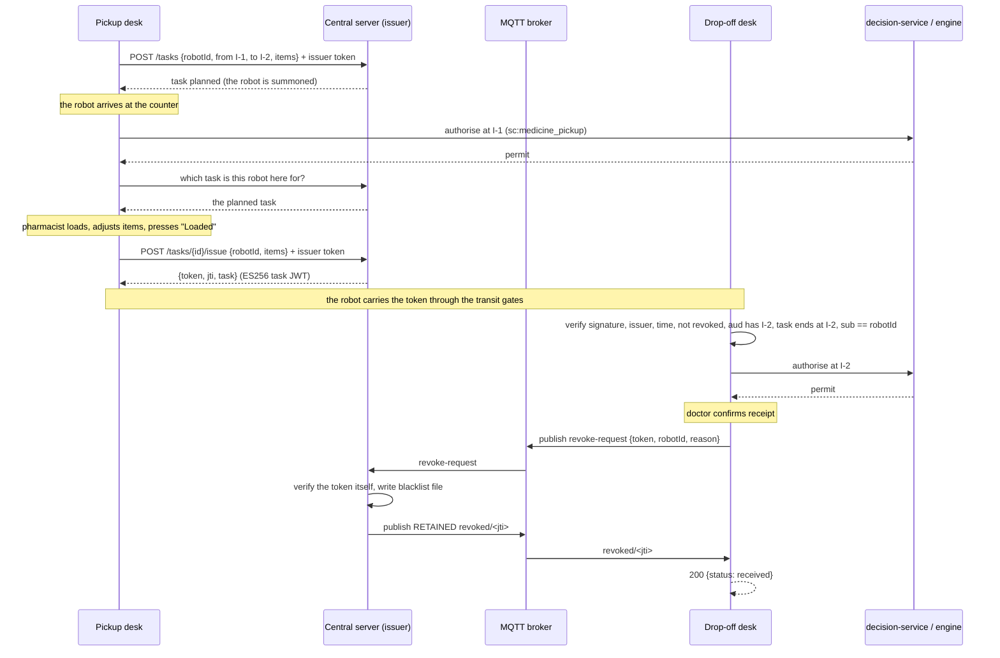

# Interaction points: pickup and drop-off

The pilot route is pickup (manned) -> transit gates (unmanned) -> drop-off (manned). This document covers the two manned interaction points, the central server that issues the task token, how the token travels between them, and the decisions and assumptions the first cut is built on. "Decisions" are the choices we made so the pilot could move; "Assumptions" are what those choices take to be true.

## What each point does

| Point | Service | Engine point | Does |
|---|---|---|---|
| Pickup (pharmacist) | pickup, port 4005 | `I-1` pharmacy pickup counter | `POST /pickup/tasks` plans a task (the pharmacy summons a robot); `POST /pickup/check` answers whether the robot may collect and which planned task it is here for; `POST /pickup`, on "Loaded", has the central server issue the token for that task. Holds no signing key. |
| Central server | central, port 4007 | - | The issuer and the record. Keeps the tasks (planned, issued, received, refused, cancelled, recalled) and the activity log, issues a planned task's token when the pickup desk asks (issuer token), keeps the blacklist and revokes over MQTT. Runs next to the broker. |
| Drop-off (doctor) | dropoff, port 4006 | `I-2` ward medicine handover (`I-3` in the clean room) | `POST /dropoff/check` shows what the robot carries; `POST /dropoff` asks the central server to revoke the token and answers "received" once it confirms. |

The desk screens for both points are in the developer and test UI, [credential-lifecycle-ui](https://github.com/Stormcatch/credential-lifecycle-ui) (pages Pickup and Drop-off), next to the phase test pages.

## The task token

The format agreed with Martin (2026-11-17): his claim structure, with the policy engine's point ids. Header `{ alg: ES256, typ: task+jwt, kid }`; payload:

```json
{
  "iss": "urn:stormcatch:central",
  "sub": "urn:stormcatch:robot:SC-M1:SN-2026-000123",
  "aud": ["urn:stormcatch:point:I-1", "urn:stormcatch:point:G-1", "urn:stormcatch:point:G-2", "urn:stormcatch:point:G-3", "urn:stormcatch:point:I-2"],
  "jti": "14bc42c7-f149-4652-bb3e-6aa5982c6d83",
  "iat": 1794909476,
  "nbf": 1794909476,
  "exp": 1794916676,
  "cnf": { "x5t#S256": "<SHA-256 thumbprint of the robot's PIC certificate, once the desks can read it>" },
  "task": {
    "id": "task-...",
    "type": "medicine-delivery",
    "payloadType": "sc:medicine",
    "from": "I-1",
    "to": "I-2",
    "items": [{ "code": "PARACETAMOL-500", "name": "Paracetamol 500 mg", "quantity": 20 }],
    "gates": ["I-1", "G-1", "G-2", "G-3", "I-2"],
    "parentTaskId": null
  }
}
```

`task.gates` is the route of the pilot procedure for that destination, and `aud` is the same list as point URNs: procedure A ends at `I-2` (`I-1, G-1, G-2, G-3, I-2`), procedure B at `I-3` (`I-1, G-1, G-2, G-4, I-4, G-5, I-3`). Martin's demo names are accepted and mapped:

| Martin's name | Engine point |
|---|---|
| `gate-pharmacy` | `I-1` |
| `gate-ward-3b` | `I-2` |

## Flow



Every step lands in the central server's activity log: the central server records planning, issuing, receipt and a refused revoke itself, and both desks report each check, passed or refused, with the reason.

## Decisions

Choices we made so the pilot could move. Each says why, and what would change it.

1. **The payload is a signed JWT, not a verifiable credential (yet).** The central server, the desks and the revocation code are written against a `PayloadBackend` interface (`src/payload/types.ts`), so a VC backend can replace the JWT one. Changes when: Paradym is stable (assumption 1); then implement the `vc` backend in `src/payload/index.ts`.
2. **ES256 keypair, not an HS256 shared secret.** The central server holds the private key; the desks and gates hold only the public key, so they can check a token but never mint one. The header's `kid` (the public key's JWK thumbprint) lets a verifier pick the right key. No certificate chain in the token: the robot's identity is its PIC certificate, and the token points at that one robot (agreed with Martin). Changes when: the team decides otherwise (open question).
3. **The central server is the issuer; the desks ask it.** Agreed 2026-11-17. The pickup desk checks the robot with the engine and, when the pharmacist presses "Loaded", asks the central server to issue the token (`POST /tasks`). Only the issuer revokes, so drop-off asks the central server to revoke over MQTT. The central server's file (`.payload/blacklist.json`) is the source of truth. This matches Martin's design, where the central server keeps the token ids.
4. **Drop-off answers "received" only after the central server confirms the revoke.** If drop-off answered first and the revoke were lost, the same token could be used again elsewhere. If the central server does not confirm within `REVOKE_TIMEOUT_MS` (default 5 s), drop-off answers 504 and the token stays live; retrying is safe because the central server answers a repeated request by announcing the same revoke again.
5. **The blacklist is shared through retained MQTT messages.** The central server announces each revoke as a retained message on `stormcatch/payload/revoked/<jti>`, so any verifier that subscribes (drop-off now, transit gates later) receives the full list, also after a restart or a lost connection. This is the "temporary gate store that syncs with the central server" of Martin's design: he did not build it, this is it. The central server re-announces its whole file on start, so a broker that lost its data is repaired.
6. **Who may publish is enforced twice.** The broker refuses anonymous clients; each service has its own login, and the ACL (`broker/acl`) lets only drop-off publish revoke requests and only the central server publish revoke announcements. On top of that, a revoke request carries the token itself, and the central server verifies the signature and the robot before revoking, so a client with broker access but without a genuine token cannot revoke anyone's payload. Not done yet: TLS on the broker connection.
7. **The central server runs the broker and the issuer.** Agreed in the team meeting of 2026-11-10: the pilot gets an always-on Raspberry Pi as its central server. Until that Pi is delivered, the developer's own machine is the central server (Frank, 2026-11-13). Every service finds the broker through `MQTT_URL` and the issuer through `CENTRAL_URL`, so moving them to the Pi is a configuration change (assumption 6).
8. **The points use the engine's own topology.** Pickup is `I-1` and requires the task action `sc:medicine_pickup`; drop-off is `I-2`, or `I-3` for the clean-room route (`DROPOFF_POINT_ID=I-3`).
9. **The desks are laptops, not Raspberry Pis.** Agreed in the team meeting of 2026-11-10: the person at pickup and at drop-off works on a laptop, which reads the robot's QR code with its webcam or with a barcode scanner that types like a keyboard (common in hospitals). No extra device per desk, so less to manage and keep updated. The desk screens are a web app (in credential-lifecycle-ui), so a tablet works too.
10. **Onboarding stays in Martin's app; everything after it is here.** Agreed in the team meeting of 2026-11-10: onboarding the hospital and the robot (KYC, certificates) stays in Martin's certificate platform. The continuation, meaning tasks, the policy engine and the MQTT revocation, belongs to this work, so the unique parts of Martin's demo after onboarding move here.
11. **The token is Martin's task JWT.** Agreed 2026-11-17 (see "The task token" above): `iss`, `sub`, `aud`, `jti`, `iat`, `nbf`, `exp`, `cnf` and the `task` object with structured items, so his demo and this work read the same token. `cnf.x5t#S256` is carried when the robot's PIC thumbprint is known (`cnfThumbprint` on `POST /tasks`); the desks do not read the robot's certificate yet (assumption 5).
12. **The token names points by the engine's ids.** Agreed 2026-11-17: `aud` and `task.gates` use `I-1`, `G-1` and so on, so the token and the policy engine talk about the same places. `aud` lists every point on the procedure's route as `urn:stormcatch:point:<id>`; drop-off refuses a token that does not name it (`wrong-point`) and a task that ends at another point. Martin's demo names are mapped (table above).
13. **The pickup desk proves itself to the central server with a shared issuer token.** Only the central server can mint, but anyone who can reach it could ask, so planning and issuing (`POST /tasks`, `POST /tasks/{id}/issue`) require `Authorization: Bearer <ISSUER_TOKEN>`, which only the pickup desk holds. On one dev machine a token is generated into `.payload/` and shared, like the dev keypair. Changes when: staff sign-in exists; then the signed-in pharmacist's session can replace the shared secret.
14. **A detour revokes the parent task.** Agreed 2026-11-17, not built yet (`parentTaskId` travels as `null`). When pharmacy A sends the robot to pharmacy B first, the central server issues the detour task with `parentTaskId` set and revokes the parent at the same time. Left valid, the parent would mean two live tokens for one robot and one load: the robot could skip the detour and present the parent at the ward, a gate could accept either, each would have to be revoked separately if the robot is compromised, and the activity log could not say which task the robot was on. The cost of revoking: if the detour is cancelled, the central server issues a fresh task for the remaining route instead of reviving the old one.
15. **Tasks are planned ahead.** Agreed 2026-11-17, as in Martin's demo and procedure A ("the pharmacy employee summons the robot"): a task (robot, destination, items) is planned first and stored on the central server; when the robot reaches the counter, "Check robot" finds its planned task, the pharmacist confirms or adjusts the items, and "Loaded" issues the token for that task. A robot has at most one planned task at a time, so the desk never has to guess which one it is here for; a planned task can be cancelled, an issued one ends at receipt.
16. **The central server keeps an activity log per task.** Agreed 2026-11-17. One line per event in `.payload/activity.jsonl`: planned, issued, received and refused revokes from the central server itself; every pickup and drop-off check, passed or refused with its reason, reported by the desks. The desks report with their own shared secret, `DESK_TOKEN`, separate from the issuer token so drop-off can report without being able to mint, and fire and forget: a desk never waits for the log, and a central server that is down only costs the log entry. Reading tasks and activity is open on the network, like the other services (assumption 4).
17. **A delivery on its way can be recalled.** Added 2026-11-17, after a delivery whose code was lost stayed "on its way" with nothing able to end it. The pharmacy side (issuer token) calls `POST /tasks/{id}/recall` (through `POST /pickup/tasks/{id}/recall`) when the robot broke down, the load was wrong or the code was lost: the central server revokes the token exactly as a receipt does, announces it over MQTT, marks the task `recalled` and logs `task.recalled` with the reason. A ward that is then shown the code refuses it with `recalled`, not "already received". A planned task is cancelled instead; a received one is finished.
18. **The ward can refuse a delivery.** Added 2026-11-23, to match the policy engine's handover policy (authorize contract 0.2.0). The nurse answers the handover: `POST /dropoff` takes `answer` (`accepted`, the default, or `refused`) and, only with a refusal, a `reason` from the engine's list: `sc:wrong_item` (not what was ordered), `sc:damaged` (damaged or seal broken), `sc:not_expected` (nobody expected it), `sc:late` (arrived too late). Either answer ends the delivery and revokes the token through the central server, as the engine requires; the revoke request carries `refused:<reason>`, so the central server marks the task `refused`, logs `task.refused` with the reason, and the robot takes the goods back to where they came from (`returnTo`, the task's `from`). A ward shown a refused code again turns it away with `refused`. The token also carries the class of goods, `task.payloadType` (default `sc:medicine`, the engine's `payloadType`), so the payload claims can be passed to the engine once the decision-service sends them.
19. **The robot carries its delivery code.** Added 2026-11-23, replacing the browser stand-in. The robot-service keeps the task tokens issued for it in its own wallet (Credo generic records in the Askar store that holds its credentials, so they survive a restart): `POST /deliveries` when the pharmacy desk sends it off, `GET /deliveries?to=<ward>` when a ward desk scans it, `DELETE /deliveries/{taskId}` when the delivery is received, refused or recalled. It reads the token's claims without checking the signature (it holds none of the central server's keys and the ward checks every token anyway), refuses a token issued to another robot (`not-this-robot`) or already expired, and drops expired codes as it lists them. Which robot it is comes from `ROBOT_ID` (the pilot robot by default) and is shown in `GET /health`. The desks only use the robot-service for that robot; any other robot's code stays in the desk's browser as before. The robot-service has no authentication, like the other services (assumption 4); on a shared network it listens on 127.0.0.1 only (`ROBOT_HOST`).
20. **The engine sees the payload the robot really carries.** Added 2026-11-23, when the engine's payload rules (authorize 0.2.0) refused every pass that named no class of goods. The decision-service takes a `payload` with the request: `{ token }` (the robot's task token, verified there with the central server's public key: signature, issuer, time window), `"none"`, or `{ held }` (what the robot carries per the central server's record). From it the engine gets `payloadType`, `payloadOrigin`, `payloadDestination` and `payloadExpiresAt`. The drop-off sends the token, and at the commit the nurse's answer (`handoverAnswer`, `refusalReason`); the pickup desk sends where the load goes (`deliverTo`) and whether the robot is still out on an issued delivery, which the engine refuses (one load at a time). A token that does not verify counts as no payload. Without any `payload` (the gates on the boxes today) the decision-service keeps a stand-in: empty at the pharmacy counter, medicine from I-1 to I-2 everywhere else, which is procedure A only. **Two issuers, two roles:** the central server signs the token (`iss`, what the desks and the decision-service verify), and the engine is told the payload's issuer is the pharmacy the load came from (`did:key:z6MkAmcPharmacy00001` for I-1, `src/payload/points.ts`), because the engine anchors issuers by DID only and procedure A has the pharmacy issue the payload.

## Assumptions

What the decisions take to be true without having checked it, and the limits we accept for the first cut. If one turns out wrong, the decision it names needs another look.

1. **Paradym is not ready for the payload.** Its issuance and verification are not stable enough for the pilot and the cloud wallet is not ready (decision 1).
2. **A short wait at the drop-off desk is acceptable to staff.** Up to `REVOKE_TIMEOUT_MS` while the central server confirms the revoke (decision 4).
3. **The number of revoked payloads stays small (pilot scale).** Every verifier holds the full revoked list in memory (decision 5).
4. **The broker runs on a trusted LAN.** Its connection is not encrypted yet (decision 6).
5. **The robot id at the points is the robot id as given.** The engine authorises the point and the errand; the robot id is bound to the payload only through the token's `sub`, and `cnf` (the PIC thumbprint) is only carried once the desks can read the robot's certificate. The decision-service reads identity from a presented birth certificate, and the manned points do not receive one yet. Person sign-in (pharmacist, doctor) is Martin's onboarding platform and out of scope here.
6. **The central server Pi is ordered but not delivered.** Until it arrives the broker and the issuer run on the developer's own machine, which the pilot boxes cannot reach, so tests on the boxes wait for the Pi (decision 7).
7. **Stopping reuse with the blacklist is enough for the pilot.** Since decision 20 the engine sees the token's claims at the desks, but the decision-service does not hold the blacklist: a received token still verifies there. Reuse is stopped by the drop-off, which checks the blacklist before it asks the engine. At the transit gates the engine still sees the baseline payload. Changes when: the gates bring the robot's token, and they then need the blacklist too (a read-only broker login).
8. **The pilot routes are the two procedures.** The central server knows the routes `I-1 -> I-2` and `I-1 -> I-3` (`src/payload/points.ts`); a task between any other points is refused (`no-route`). Changes when: the facility defines routes of its own.
9. **The files are enough for the pilot.** Tasks and activity are JSON files on the central server, read whole on every request. Changes when: the number of tasks or events makes that slow; then a database behind the same `TaskStore` and `ActivityLog` calls.

## Running it locally

Add two broker passwords to `.env` (any long random strings; the broker builds its password file from them on every start, so none is committed). The broker login for the issuer is `central`:

```sh
CENTRAL_MQTT_PASSWORD=...
DROPOFF_MQTT_PASSWORD=...
```

Then, with the engine and decision-service up:

```sh
docker compose up -d broker
pnpm central
pnpm pickup
pnpm dropoff
node --import tsx --test test/central.test.ts test/pickup.test.ts test/dropoff.test.ts
```

| Variable | Default | Used by |
|---|---|---|
| `MQTT_URL` | `mqtt://localhost:1883` | central, dropoff |
| `CENTRAL_MQTT_PASSWORD`, `DROPOFF_MQTT_PASSWORD` | none (required) | broker, central, dropoff |
| `CENTRAL_URL` | `http://localhost:4007` | pickup, dropoff |
| `ISSUER_TOKEN` | dev token in `.payload/dev-issuer-token` | central, pickup |
| `DESK_TOKEN` | dev token in `.payload/dev-desk-token` | central, pickup, dropoff (reporting events) |
| `TASKS_FILE`, `ACTIVITY_FILE` | `.payload/tasks.json`, `.payload/activity.jsonl` | central |
| `ISSUER_ID` | `urn:stormcatch:central` | central, dropoff |
| `REVOKE_TIMEOUT_MS` | `5000` | dropoff |
| `PICKUP_POINT_ID`, `DROPOFF_POINT_ID` | `I-1`, `I-2` | pickup, dropoff |
| `POINT_AUTH_ACTION`, `POINT_AUTH_SCOPE` | `sc:medicine_pickup`, none | pickup, dropoff |
| `PAYLOAD_PRIVATE_KEY`, `PAYLOAD_PUBLIC_KEY` | dev keypair in `.payload/dev-keys.json` | central (both), dropoff (public) |
| `PAYLOAD_TTL_SECONDS` | `7200` | central |
| `PAYLOAD_DATA_DIR`, `PAYLOAD_BLACKLIST_FILE` | `.payload`, `.payload/blacklist.json` | central |

## Next

The box test plan and the UI plan are in [interaction-points-next.md](./interaction-points-next.md). Verifying the person at the drop-off is designed in [dropoff-staff-verification.md](./dropoff-staff-verification.md).

## Still open

- Do the transit gates check the task token in the first cut? If yes, a gate subscribes to `stormcatch/payload/revoked/+` with its own read-only login (one ACL line) and verifies with the public key and its own point in `aud`.
- ES256 or HS256 (decision 2).
- TLS on the broker (decision 6).
- How the central server reaches the policy engine: engine and decision-service on the same Pi, or janus's decision-service opened to the network with a token (decision 7, with Rocco).
- The detour flow (decision 14): issuing a child task with `parentTaskId` and revoking the parent in one step.
- Martin's demo and these screens now both create tasks and show activity; whether his task pages call this central server or stay a separate demo (decision 10).
- The transit gates bringing the robot's token to the decision-service (decision 20, assumption 7): the robot carries it (decision 19), but the gate flow on the boxes passes only the Paradym presentation.
