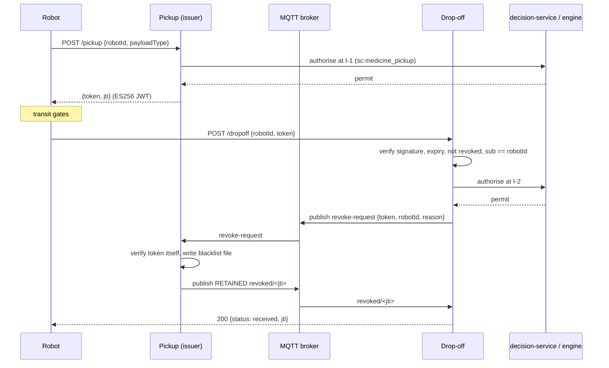

# Interaction points: pickup and drop-off

The pilot route is pickup (manned) -> transit gates (unmanned) -> drop-off (manned). This document covers the two manned interaction points, how the payload travels between them, and the decisions and assumptions the first cut is built on. Anything listed under "Decisions and assumptions" is a choice we made so the pilot could move; each one says what would change it.

## What each point does

| Point | Service | Engine point | Does |
|---|---|---|---|
| Pickup (pharmacist) | pickup, port 4005 | `I-1` pharmacy pickup counter | `POST /pickup/check` answers whether the robot may collect; `POST /pickup` issues the payload token with the medication list. Pickup is the only service that revokes a payload. |
| Drop-off (doctor) | dropoff, port 4006 | `I-2` ward medicine handover (`I-3` in the clean room) | `POST /dropoff/check` shows what the robot carries; `POST /dropoff` asks pickup to revoke the token and answers "received" once pickup confirms. |

The desk screens for both points are in [`ui/`](../ui/README.md).

## Flow



## Decisions and assumptions

1. **The payload is a signed JWT, not a verifiable credential (yet).** Paradym issuance and verification are not stable enough for the pilot and the cloud wallet is not ready. Pickup, drop-off and the revocation code are written against a `PayloadBackend` interface (`src/payload/types.ts`), so a VC backend can replace the JWT one. Changes when: Paradym is stable; then implement the `vc` backend in `src/payload/index.ts`.
2. **ES256 keypair, not an HS256 shared secret.** Pickup holds the private key; verifiers hold only the public key, so a gate or drop-off can check a token but never mint one. Changes when: the team decides otherwise (open question).
3. **Only the issuer revokes; drop-off revokes by proxy over MQTT.** The issuer must revoke its own credential, so drop-off publishes a revoke request and pickup performs the revoke. Pickup's local file (`.payload/blacklist.json`) is the source of truth.
4. **Drop-off answers "received" only after pickup confirms the revoke.** If drop-off answered first and the revoke were lost, the same token could be used again elsewhere. If pickup does not confirm within `REVOKE_TIMEOUT_MS` (default 5 s), drop-off answers 504 and the token stays live; retrying is safe because pickup answers a repeated request by announcing the same revoke again. Assumption: a short wait at the desk is acceptable to staff.
5. **The blacklist is shared through retained MQTT messages.** Pickup announces each revoke as a retained message on `stormcatch/payload/revoked/<jti>`, so any verifier that subscribes (drop-off now, transit gates later) receives the full list, also after a restart. Pickup re-announces its whole file on start, so a broker that lost its data is repaired. This answers the earlier open question of sharing the blacklist across devices without a separate central database. Assumption: the number of revoked payloads stays small (pilot scale), since every verifier holds the full list in memory.
6. **Who may publish is enforced twice.** The broker refuses anonymous clients; each service has its own login, and the ACL (`broker/acl`) lets only drop-off publish revoke requests and only pickup publish revoke announcements. On top of that, a revoke request carries the token itself, and pickup verifies the signature and the robot before revoking, so a client with broker access but without a genuine token cannot revoke anyone's payload. Assumption: the broker runs on a trusted LAN. Not done yet: TLS on the broker connection.
7. **The broker runs on janus for the pilot.** It is the always-on central box that already runs the engine, decision-service and gate, and Frank's hardware is not available yet. Every service finds the broker through `MQTT_URL`, so moving it is a configuration change. Changes when: the central server arrives.
8. **The points use the engine's own topology.** Pickup is `I-1` and requires the task action `sc:medicine_pickup`; drop-off is `I-2`, or `I-3` for the clean-room route (`DROPOFF_POINT_ID=I-3`).
9. **Robot identity at the points is the robot id as given.** The engine authorises the point and the errand; the robot id is bound to the payload only through the token's `sub`. The decision-service reads identity from a presented birth certificate, and the manned points do not receive one yet. Person sign-in (pharmacist, doctor) is Martin's onboarding platform and out of scope here.
10. **The engine screens baseline payload facts, not the token.** At the handover the engine checks payload issuer and expiry from the decision-service's fixed baseline. Reuse is stopped by the blacklist, not by the engine. Changes when: the token's claims are passed into the engine request.

## Running it locally

Add two passwords to `.env` (any long random strings; the broker builds its password file from them on every start, so none is committed):

```sh
PICKUP_MQTT_PASSWORD=...
DROPOFF_MQTT_PASSWORD=...
```

Then, with the engine and decision-service up:

```sh
docker compose up -d broker
pnpm pickup
pnpm dropoff
node --import tsx --test test/pickup.test.ts test/dropoff.test.ts
```

| Variable | Default | Used by |
|---|---|---|
| `MQTT_URL` | `mqtt://localhost:1883` | pickup, dropoff |
| `PICKUP_MQTT_PASSWORD`, `DROPOFF_MQTT_PASSWORD` | none (required) | broker, pickup, dropoff |
| `REVOKE_TIMEOUT_MS` | `5000` | dropoff |
| `PICKUP_POINT_ID`, `DROPOFF_POINT_ID` | `I-1`, `I-2` | pickup, dropoff |
| `POINT_AUTH_ACTION`, `POINT_AUTH_SCOPE` | `sc:medicine_pickup`, none | pickup, dropoff |
| `PAYLOAD_PRIVATE_KEY`, `PAYLOAD_PUBLIC_KEY` | dev keypair in `.payload/dev-keys.json` | pickup, dropoff |
| `PAYLOAD_TTL_SECONDS` | `7200` | pickup |
| `PAYLOAD_DATA_DIR`, `PAYLOAD_BLACKLIST_FILE` | `.payload`, `.payload/blacklist.json` | pickup |

## Next

The box test plan and the UI plan are in [interaction-points-next.md](./interaction-points-next.md).

## Still open

- Do the transit gates check the payload token in the first cut? If yes, a gate subscribes to `stormcatch/payload/revoked/+` with its own read-only login (one ACL line) and verifies with the public key.
- ES256 or HS256 (decision 2).
- TLS on the broker, and where the broker finally lives (decision 7).
- Passing the token's claims into the engine request (decision 10).
